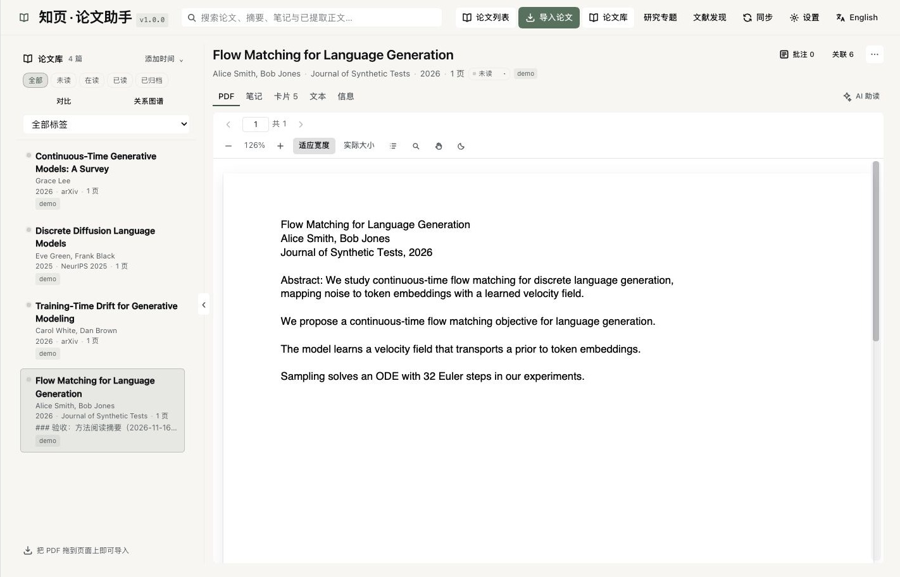
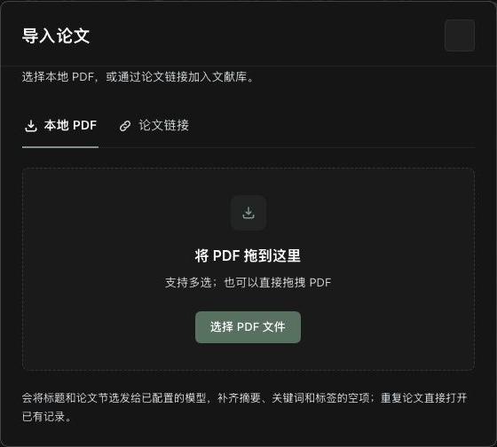
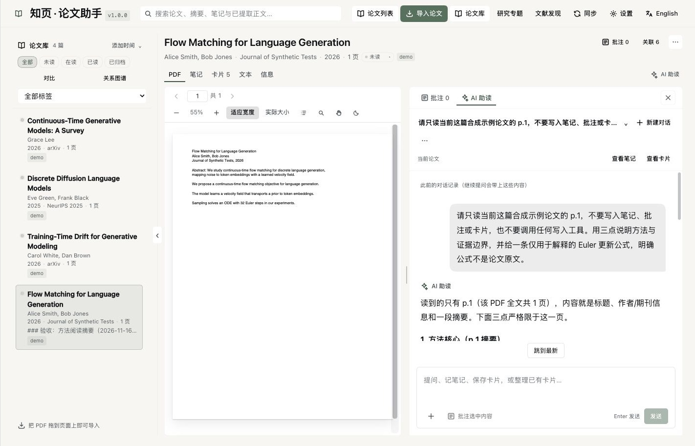
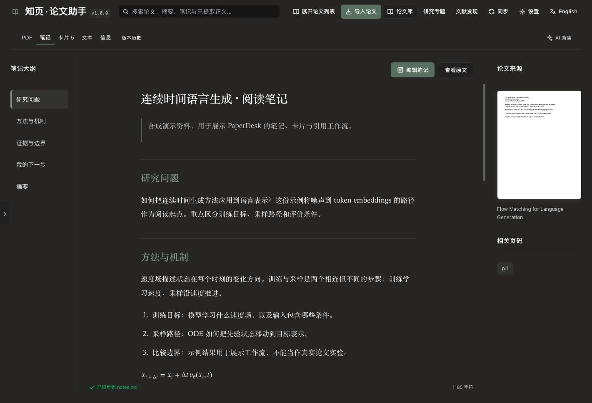
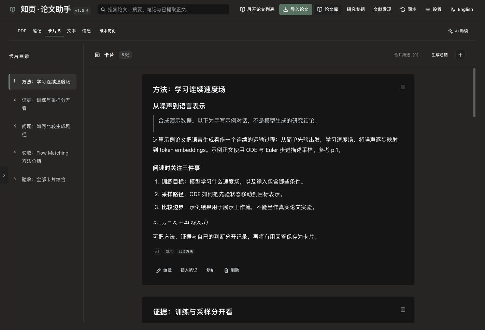
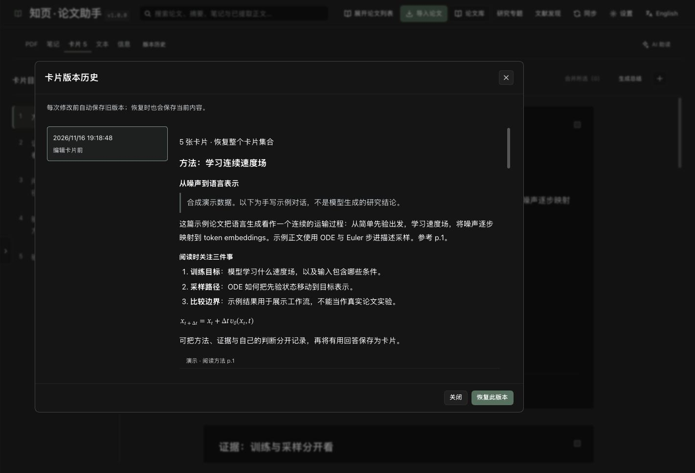
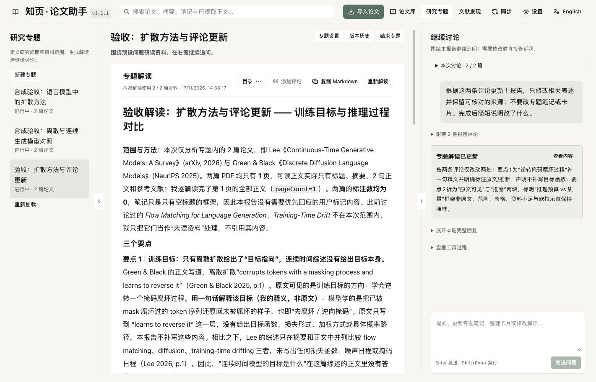
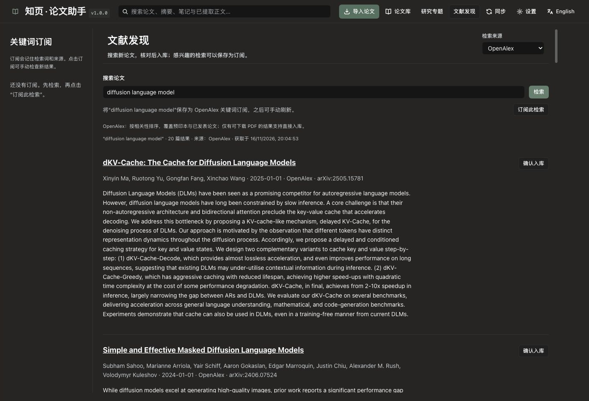

# 知页 · 论文助手

知页是 DeepSeek Harness 的论文管理与 AI 研读助手。导入 PDF，在同一工作台阅读、批注、提问和整理笔记，再围绕研究专题比较与发现文献。

论文库直接保存在你选择的目录中：PDF、Markdown 笔记和 JSON 元数据都是普通文件，可以交给自己的网盘客户端同步。

**当前版本：1.1.1** · [本版更新说明](docs/RELEASE-v1.1.1.md) · [安装与发布说明](docs/PUBLISHING.md)

## 功能概览

| 能力 | 说明 |
| --- | --- |
| 论文导入 | 上传、拖拽、多行链接批量导入、扫描 `_inbox/`，或通过 `paper_add` 按路径导入；相同 PDF 自动去重。 |
| 元数据 | 提取标题、作者、年份、DOI 等信息；可用 Crossref 补全，并用当前配置的模型补齐空的摘要、关键词和标签。 |
| PDF 阅读 | 连续滚动、缩放、旋转、目录、全文查找、页内与外部链接、手型拖动和深色纸张。 |
| 高亮与批注 | 选中文字后高亮、划线、备注或提问；批注按页整理，可编辑、删除或交给 AI 解答。 |
| AI 助读 | 在阅读器旁流式问答，支持独立对话、自然语言任务、原页图片附件、引用页核对和回答批注；按要求记录笔记或卡片。 |
| 笔记与卡片 | Markdown 整页阅读、分节目录、自动保存；回答可保存为独立卡片，再编辑或插入论文笔记。 |
| 研究专题 | 创建后自动解读预设问题；右侧继续讨论、编辑专题笔记和卡片、更新解读，并保留可恢复版本。 |
| 文献发现 | 选择 arXiv 或 OpenAlex 搜索，保存检索订阅，手动检查新文献并确认入库。 |
| 对比与图谱 | 对比 2–6 篇论文，保存对比报告；管理引用、相关、方法、对比等论文关系。 |
| 本地管理 | 阅读状态、评分、标签、BibTeX 导出、文件定位、冲突副本和中英文界面。 |

论文阅读、助读、导入及卡片等截图来自 1.0 界面审查，使用合成演示库；文献发现展示公开 OpenAlex 结果。AI 助读图包含一次真实的只读模型回答，演示内容不作为研究结论。截图的来源和裁切记录见 [截图记录](docs/screenshots/v1.0.0/public-candidates-manifest.json)。1.0 的验证范围与未覆盖边界见 [1.0 发布说明](docs/RELEASE-v1.0.0.md)；1.1 的专题与导入变更单独验证，见 [1.1 发布说明](docs/RELEASE-v1.1.0.md)。



## 1.1.1 的专题工作台

- 主区集中阅读解读，目录可跳转分节，复制保留原始 Markdown 和公式。初始解读使用独立会话，右侧用于后续讨论。
- 两侧分隔线可以拖动调整宽度，箭头原位收起和展开；宽度与展开状态会记住。分隔线也支持键盘调整，较窄窗口以侧面板查看专题列表和讨论。
- 选中解读文字后点击“添加评论”，在右侧编辑并完成。可积累多条评论，和普通问题一起发送；划词本身不会弹窗或调用模型。
- 明确要求修改时，聊天显示实际保存结果和简短摘要，点击可查看文档；原始完整回答仍能展开和复制。
- 导入弹窗固定外框与底部状态区，进度、结果和错误在内部变化，减少窗口跳动。

## 1.1 的主要变化

- 创建研究专题后自动围绕预设问题解读论文。主区展示解读，研究问题与文献收进“专题设置”。
- 在右侧直接要求更新专题笔记、创建或整理专题卡片、修改解读。专题卡片独立保存，并关联来源论文；修改前自动保留版本。
- 专题资料不再有 30 篇硬限制。本次讨论范围单独选择；超出应用资料预算时明确提示缩小范围，不静默丢弃已选论文。
- PDF/arXiv 链接每行一条批量导入，逐项显示结果并重试失败项。
- 阅读状态使用固定位置的菜单。保存实际笔记、卡片或加入进行中的专题时，仅未读论文自动变为在读；结束专题时可选择批量标记已读，归档保持不变。

## 1.0 的界面整理

- **知页 · 论文助手**：中文名称直观表达论文阅读与整理用途，英文为 Paper Companion。原有安装标识和论文库继续兼容。
- **左右对话**：用户问题在右侧气泡，AI 回答在左侧；正文统一字号，长问题默认完整显示，每轮只保留一个过程入口和一次原文复制。
- **统一导入**：一个“导入论文”入口支持本地多份 PDF、拖放与论文链接；导入状态和失败重试集中显示。
- **编辑与恢复**：通过对话重写笔记，合并、拆分、删除或排序卡片。修改前保留历史，可预览、恢复和撤销恢复。
- **一致的操作方式**：统一弹窗、按钮和低饱和配色，补齐键盘导航、焦点返回与删除确认。左侧统一使用纵向论文列表，排序使用与整体一致的菜单。



## 安装与快速开始

### 从源码使用当前版本

```sh
git clone https://github.com/ZhexuanZhou/dsh-paper-desk.git
cd dsh-paper-desk
pnpm install
npm run build
```

在 Harness 的插件管理器中从本地目录安装，选择构建后的仓库目录。桌面 profile 由 Harness 应用管理；Host 代码更新后需要在插件管理器中关闭再开启插件，浏览器界面更新后需要刷新页面。

对于命令行维护的 profile，也可以使用：

```sh
dsh plugin --profile <profile> add /path/to/dsh-paper-desk
```

### 从 GitHub Release 安装

从 [最新 Release](https://github.com/ZhexuanZhou/dsh-paper-desk/releases/latest) 下载预构建安装包。当前 GitHub Release 为 1.1.1。命令行维护的 profile 可安装：

```sh
dsh plugin --profile <profile> add https://github.com/ZhexuanZhou/dsh-paper-desk/releases/download/v1.1.1/dsh-paper-desk-1.1.1.tgz
```

Release 同时提供安装包的 `SHA256SUMS` 校验文件；合成演示库位于源码的 `demo/library/`。

### 从 npm 安装

公开包名为 `@zhe_xuan/dsh-paper-desk`：

```sh
dsh plugin --profile <profile> add @zhe_xuan/dsh-paper-desk
```

Git tag 与 npm 发布是独立操作。从 npm 安装得到的是 registry 已发布版本，未必与当前源码版本相同，可用 `npm view @zhe_xuan/dsh-paper-desk version` 查询。

### 创建论文库

1. 打开侧边栏的“知页 · 论文助手”入口。
2. 在设置中选择论文库目录，也可以使用默认目录。若要多设备同步，可选择自己的网盘目录。
3. 点击“导入论文”，选择“本地 PDF”上传或拖入文件，也可切换“论文链接”粘贴 arXiv 页面、编号或公开 PDF 直链，每行一条。链接按顺序处理，逐项显示已导入、已在库中或失败；可单项重试或重试所有失败项。关闭弹窗后，本次页面中的队列继续执行，刷新或关闭页面不会自动续传。也可以把文件放入 `<库>/_inbox/`，再扫描收件箱。
4. 在“信息”页核对元数据；空的摘要、关键词或标签可以点击“用 LLM 补全空项”重试补全。

## AI 助读

在阅读器中打开 **AI 助读**，即可一边看 PDF，一边讨论当前论文。



- **提问**：在输入框直接输入问题，点击发送。Enter 发送，Shift+Enter 换行；输入法选词期间 Enter 用于完成选词。
- **对话阅读**：你的消息显示在右侧气泡，AI 回答在左侧。每轮回答只显示一次 AI 标识，思考和工具收进一个过程入口，整轮提供一次 Markdown 复制。两者使用同一正文字号和低饱和配色。问题默认显示全文；超过八行时可手动收起为四行，再展开查看。调整面板宽度后，已不需要折叠的问题会自动恢复完整显示。
- **直接说需求**：输入“总结方案”“将结论记入笔记”“保存为卡片”或“整理所有卡片”，由 Agent 选择工具执行。普通总结和讨论只读；明确要求记录时直接保存，并反馈结果。“重新整理笔记”会更新原笔记；“合并、拆分、删除或整理卡片”会按要求重组原卡片。默认处理当前论文，跨论文时请指定范围。
- **原页图片**：通过输入框的附件入口添加页码，最多 3 个不同页面。附件会显示明确页码，可编辑或逐个移除；翻动 PDF 不会改变已附页码。
- **阅读回答**：支持 Markdown、公式、列表、表格和代码；推理与工具过程可展开查看。生成中可以停止，向上阅读时不会强行跟随滚动，可点击“跳到最新”返回。
- **核对引用**：每条回答独立列出引用页面。点击后查看 PDF 原页或提取文本，再跳回阅读器。页码来自回答中的引用标记，有页码不代表结论已核实。
- **复制与记录**：“复制 Markdown”保留回答的原始公式和格式。需要保存时直接输入“将这段结论记入笔记”或“保存为卡片”，Agent 写入后会说明结果。
- **回答批注**：划词只保留正常选区，不自动打开编辑区。选中回答文字后，点击输入框下方的“批注选中内容”，写问题或评论。编辑后点击“完成”，会保存评论并将引用和评论带入正常输入框，保留已有草稿；可以继续修改，再自行发送。已保存的评论可在对话底部展开“N 条回答批注 · 查看”重新编辑。本轮评论随当前草稿发送，历史评论不自动附加到以后的每条问题。这些回答评论仅保存在当前浏览器或 Harness 的本地存储，不写入论文笔记、卡片或 PDF 批注，也不随论文库同步。需要长期保存时，请让 Agent 整理进笔记或卡片。

原页以最长边 2000px 的 JPEG 发送给当前会话模型。普通文字提问不自动附图；“加入提问”先把 PDF 选段和页码带入正常输入框，原页图片可通过附件入口添加。使用已有 PDF 批注中的提问入口时，会附上其对应原页。图片处理或模型请求失败会提示错误，不静默改成纯文字请求。

### 对话与草稿

每篇论文支持多条独立对话。顶部可切换或新建对话；重命名、删除、回答字号和“在完整会话中继续”位于更多菜单。

- 对话文本保存在 `papers/<id>/chats.json`，随论文库同步。
- 输入框的未发送文字和图片附件按论文及对话保留在本机；请求失败会保留草稿。
- 宿主 session 用于执行模型请求。删除宿主 session 不会删除插件已保存的对话；重新提问时可依据历史记录创建本地执行会话。
- 跨设备可以继续使用同步后的对话文本，但宿主 session 和未发送草稿不随论文库同步。

## PDF 批注、笔记与卡片

### PDF 批注

选中文字后可高亮、划线、备注、提问或复制。点击已有标注可以定位对应批注；右侧按页管理批注。

- `Cmd/Ctrl+Z`：撤销批注操作。
- `Delete/Backspace`：删除当前选中批注。
- `Esc`：关闭批注面板。

批注保存在 `annotations.json`。扫描版 PDF 可能没有可选中文字，插件会提示可提取文本较少；可在外部完成 OCR 后重新导入。

### 论文笔记

“笔记”页默认显示排版后的 Markdown：分节目录用于定位，正文旁可核对引用原页。支持编辑、自动保存和 `Cmd/Ctrl+S`；保存冲突会提示处理，不覆盖其他设备的修改。



### 通过对话保存卡片

在 AI 助读中输入“将这个结论保存为卡片”。Agent 会先读已有卡片再保存，并反馈结果。输入“整理所有卡片”会读取当前论文全部卡片，按要求修改、合并、拆分、删除或排序；不再固定保留重复卡片或新增综合卡片。跨论文整理时请指定范围。

卡片阅读页和编辑预览使用相同的字体、标题层级和表格字号，正文与卡片标题左对齐。正文开头若是同名标题或独立同名段落，仅展示时隐藏一次；编辑源码、复制、插入笔记和已保存内容保持原样。编辑预览可切换源码模式，标题、标签、来源页码和上下文按需展开。


在卡片编辑器中，“根据对话生成”会调用模型，依据所选上下文重新整理标题和正文；手工编辑后点击保存不会额外调用模型。

保存后，在独立“卡片”页按目录阅读全文，或编辑、核对页码、复制、插入笔记和删除。卡片保存在 `cards.json`，不会自动写入论文笔记。



## 编辑与版本恢复

直接输入“把笔记重新整理成一篇文档”“合并重复卡片并拆开方法与实验内容”或“恢复整理前的笔记”。Agent 会先读取已有内容，再按要求编辑指定对象；普通提问仍只读。默认保留引用和个人判断，明确要求修改或删除时按你的要求执行。

在“笔记”或“卡片”页点击 **版本历史**，选择一个版本先预览，再点击 **恢复此版本**。卡片历史对应整个卡片集合。恢复后可点击 **撤销本次恢复**，或从最新历史找回恢复前状态。若内容又被其他操作修改，旧的恢复/撤销请求会被拒绝，需要重新核对。



历史仅覆盖启用版本记录后的修改，保存于 `<库>/.paperdesk/history/<论文ID>/notes/` 或 `cards/`。已有笔记第一次修改时会先保存当前内容；更早且从未记录的编辑无法重建。历史保存原始 Markdown/JSON，不自动清理版本，存储占用会随修改增加。导入时创建的初始模板不视为一次用户编辑。

笔记重写和卡片重组使用读取时的版本进行校验。单个 Host 内写入串行执行，写入前再次检查外部修改；这不等同于跨设备分布式事务。检测到冲突时保留已有内容并报告；不要用重复提交绕过冲突。

## 研究专题与文献发现

### 研究专题

填写研究问题并选择论文，点击“创建并开始解读”。知页会自动生成专题解读，按预设问题比较证据、发现缺漏和提出可核对的建议。主区以解读为主，右侧继续追问；研究问题和关联论文在“专题设置”中查看、增加或移除。



截图来自 1.1.1 隔离合成库的真实界面，展示主报告、两条已发送评论和实际更新回执，画面与来源说明见 [截图记录](docs/screenshots/v1.1.1/manifest.json)。演示内容不作为研究结论。其余未改动页面的 1.0 截图继续保留原版本标注。

专题收纳的文献没有 30 篇硬限制。“本次讨论”单独选择参考范围；应用为每次整理后的资料设置 60000 字符预算，超过时会明确要求缩小本次范围，不删除专题资料，也不静默忽略所选论文。这是应用字符预算，不是模型的 token 上限。摘要、笔记、卡片和对比使用有长度提示的节选，正文通过 `paper_text` 按需补读；节选不等同于全文证据。

在右侧说“更新专题笔记”“把证据缺口整理成专题卡片”或“根据这轮讨论修改解读”，Agent 会读取当前版本并执行实际编辑。普通追问保持只读。专题卡片保存在专题中，以论文 ID 关联来源，不会默认写入单篇论文卡片。主区下方可展开笔记和专题卡片。

选中主报告中的文字，点击工具栏的“添加评论”，在右侧写下看法，再点击“完成”。可以编辑、移除或继续添加多条评论，最后在正常输入框提问并发送。评论保留引用、所属分节、报告版本和相关公式；旧版引用会标出，不自动套用到新版位置。添加评论不会自行修改解读、笔记或卡片。未发送内容只保存在当前浏览器的本地草稿中，不随论文库同步；存储不可用时会提示。

拖动两条分隔线可以调整专题列表和讨论宽度；点击箭头原位收起或展开。聚焦分隔线后，方向键调整 20 像素，Shift 加方向键调整 80 像素，Home/End 调到边界，双击恢复默认宽度。拖动时按 Escape 取消。窗口较窄时，侧栏以覆盖面板打开，保留主报告的阅读空间。

右侧的保存回执来自实际成功的文档操作，不仅依据模型声称“已完成”。点击“查看文档”可查看更新结果；完整原回复和工具过程按需展开。旧会话里混入的初始解读记录会折叠保留，新解读不会复用右侧的空会话。

“版本历史”分别预览和恢复解读、笔记及卡片集合。恢复仅影响所选文档，研究问题、关联文献、专题状态和全局论文状态不跟着回退；恢复前的内容也会保留为历史。历史记录位于 `<库>/.paperdesk/topic-history/<专题ID>/`，不自动清理。

- 新专题自动开始一次解读；重新打开已保存专题不重复调用模型。问题或文献范围改变后会保留旧解读并提示更新。
- 在本次页面中切换功能，已启动的主解读仍会继续；刷新或关闭整个页面后不承诺自动恢复运行，需要检查已保存结果并按需重试。
- 结束专题可选择把关联论文批量标记已读；默认只结束专题。已读论文不会因记笔记或重新加入活跃专题而退回在读，归档论文保持归档。

### 文献发现



- arXiv 按提交时间排序，OpenAlex 按相关度排序，每次最多返回 20 篇。
- 检索词可保存为带来源的订阅，通过手动刷新检查更新；当前没有后台定时轮询或任意 RSS URL 接入。
- 每个来源独立排队、合并相同在途请求，并缓存成功结果 15 分钟。遇到上游限流时显示冷却状态并遵守 `Retry-After`。
- arXiv 不可用时可以手动选择 OpenAlex，不会自动更换检索来源。
- 论文须确认后才入库。可按 arXiv ID 或 DOI 提示已在库内；同名仅作候选提示，不自动合并。没有可下载 PDF 的结果仍可打开论文链接。

专题和订阅保存在 `<库>/.paperdesk/research.json`，关联现有论文 ID，不复制 PDF。

## 论文对比与关系图谱

勾选 2–6 篇论文进行对比：先看元数据矩阵，再生成 AI 对比报告。报告可保存到 `<库>/comparisons/`，后续重新打开；关系建议需要明确确认后才加入图谱。

图谱支持引用、相关、方法、对比、同主题和自定义关系。可以手动添加和编辑，也可以让 AI 提出候选后确认，或从参考文献中补全库内引用。

设置中的“导入后自动解析参考文献补引用”默认关闭，开启后可在导入时补建库内 `cites` 关系。图谱数据保存在 `.paperdesk/relations.json`；Agent 的关系读取工具不会自动写入关系。

## Agent 工具

在任意宿主会话中，都可以让 Agent 使用论文库工具。

| 工具 | 用途 |
| --- | --- |
| `paper_list` / `paper_search` | 按条件列出论文，或搜索标题、作者、标签、摘要、笔记与已抽取正文。 |
| `paper_info` / `paper_text` | 读取元数据或指定页的正文；首次抽取会缓存文本。 |
| `paper_annotations` / `paper_cards` | 读取批注与笔记卡片。 |
| `paper_relations` | 只读查询论文关系。 |
| `paper_notes_read` / `paper_note_append` | 读取笔记或追加内容。 |
| `paper_notes_write` / `paper_notes_replace` | 重写笔记或替换指定段落，校验读取版本并保留历史。 |
| `paper_card_create` / `paper_card_update` / `paper_cards_edit` | 新建、编辑卡片，或批量合并、拆分、删除和排序。 |
| `paper_history_list` / `paper_history_read` / `paper_history_restore` | 列出、预览和恢复笔记或卡片历史。 |
| `research_topic_read` / `research_topic_edit` / `research_topic_history` | 读取、编辑和恢复专题解读、笔记及卡片；写入需校验当前文档版本。 |
| `paper_add` / `paper_update` | 导入本地 PDF，或修改元数据、标签、状态与评分。 |
| `paper_sync` | 检查外部变更、网盘文件状态与冲突。 |

搜索按字面子串匹配，不需要额外包裹引号或使用搜索引擎语法。正文需先通过“文本”页或 `paper_text` 完成抽取，才会进入内容搜索。

## 数据、同步与隐私

```text
<论文库>/
  papers/<id>/
    paper.pdf
    meta.json
    notes.md
    annotations.json
    cards.json
    chats.json
    text.json
  comparisons/
  _inbox/
  .paperdesk/
    research.json
    topic-history/
    relations.json
    scan.json
    conflicts/
    trash/
    cache/
```

- 文件同步由你配置的网盘客户端负责。删除的论文先移入回收站，文本缓存可以重建。
- 笔记等内容写入使用哈希检查及冲突副本；跨设备同时编辑同一文件仍应尽量避免。
- 导入时的 LLM 补全会把标题、已有摘要/关键词/标签及前 4 页最多 7000 字符的节选发给配置的模型。已有非空字段保留；模型不可用或结果不足时显示警告，论文仍保存。
- AI 助读会把相关文字、笔记及你明确附上的原页图片交给宿主配置的模型服务。请依据该服务的数据处理规则使用。
- Crossref 补全发送标题或 DOI；文献发现向所选 arXiv 或 OpenAlex 发送检索词，不发送本地论文全文。

## 设置与故障排查

在面板设置中选择库目录、界面语言、Crossref 补全、收件箱扫描及引用补全等选项。也可由命令行 profile 的插件配置提供默认值。

| 配置键 | 默认 | 说明 |
| --- | --- | --- |
| `libraryPath` | 未配置 | 论文库目录，支持 `~/…`。 |
| `language` | `zh` | 中文或英文。 |
| `enrich` | `true` | 允许 Crossref 元数据补全。 |
| `autoImportInbox` | `true` | 为收件箱流程保留的配置项；扫描通过面板触发。 |
| `citationSync` | `false` | 导入后补全库内引用关系。 |
| `maxPdfBytes` | `0` | 上传大小上限；`0` 表示不限制。 |

运行时设置优先于插件配置；`DSH_PAPER_DESK_LIBRARY` 可作为未配置时的库路径回退。默认设置文件位于 `~/.dsh/paper-desk/settings.json`，实际位置随 `DSH_HOME` 而变。

| 现象 | 处理 |
| --- | --- |
| 没有论文库入口或后端无法连接 | 在插件管理器确认已启用；Host 更新后关闭再开启插件，并刷新界面。 |
| PDF 缺失或为空 | 检查库目录、文件是否存在，以及网盘占位文件是否已下载。 |
| AI 没有回应 | 查看侧栏连接或错误状态，可停止、重试，或创建新的对话。 |
| 搜索不到正文 | 打开“文本”页触发抽取；扫描件可先在外部完成 OCR。 |
| 笔记保存冲突 | 重新加载磁盘内容并合并，或明确选择保留自己的版本。 |
| 元数据不准或为空 | 在“信息”页手动修改，或分别使用 Crossref 和“用 LLM 补全空项”。 |

## 示例库与开发

`demo/library/` 包含合成论文与示例关系，用于尝试阅读、关联和引用功能，不是真实研究证据。可以复制到自选目录后作为论文库打开。

```sh
pnpm install
npm run typecheck
npm run build
npm run test:regression
npm run test:markdown
npm run test:ai-composer
npm run test:ui-state
npm run smoke

# 可选：生成独立示例库，避免覆盖现有目录
node scripts/make-demo-library.mjs --out /path/to/demo-library
```

`test:markdown` 同时执行源码与实际发布模块，比较正文、分节预览和目录输出，防止构建产物改变渲染语义。其他专项命令见 `package.json`。

开发目录：`src/` 为 Host，`client/` 为浏览器界面，`scripts/` 为构建及验证；契约文档包括 [DESIGN.md](DESIGN.md)、[DESIGN-AI.md](DESIGN-AI.md)、[DESIGN-VIEWER.md](DESIGN-VIEWER.md) 和 [DESIGN-FEATURES.md](DESIGN-FEATURES.md)。

## English summary

Paper Companion (知页) is a paper-management and AI reading plugin for DeepSeek Harness. Import PDFs, read and annotate them beside a persistent per-paper conversation, attach original page images, and save useful answers as notes or cards. Research topics organize multiple papers around a question; discovery supports arXiv and OpenAlex, while comparison reports and a typed relation graph connect the library.

All library content lives in ordinary PDF, Markdown and JSON files under a directory you choose. Your cloud-drive client handles synchronization. AI requests use the host's configured model service; Crossref and discovery requests send the metadata or search terms described above. The source version and npm release version may differ. See [publishing](docs/PUBLISHING.md) for package and distribution details.
