# PaperDesk · 论文库插件（dsh-paper-desk）

一个把「普通目录」变成 Mendeley 式论文库的 DeepSeek Harness 插件：左边栏一个「论文库」图标，打开就是原生工作台 —— 导入 PDF、自动补全元数据、记笔记与高亮、一键让 Agent 精读论文；整个论文库就是一堆普通文件，放进 iCloud / Dropbox / 坚果云等网盘目录即可多设备同步。

> 已安装在当前 `desktop` profile 中（Plugin Manager 里显示为 **论文库 PaperDesk**）。首次使用见「快速开始」。

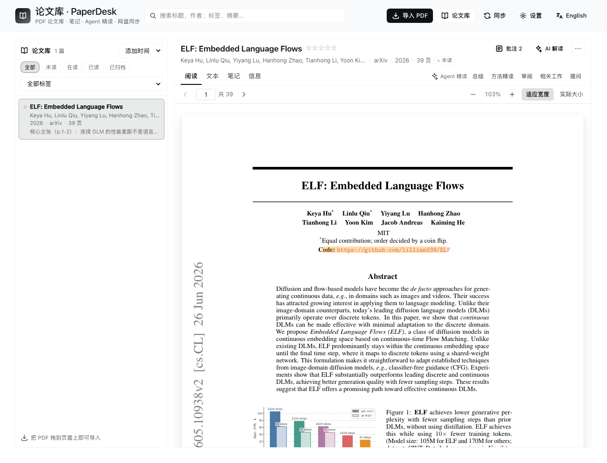

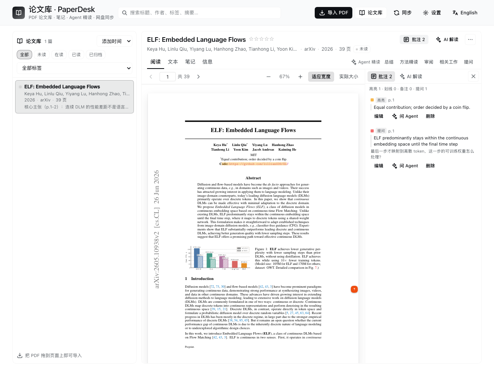

## 功能

| 能力 | 说明 |
| --- | --- |
| 论文库 | 你指定一个目录作为库根；每篇论文一个目录，含 `paper.pdf`、`meta.json`、`notes.md`、文本缓存。 |
| 导入 PDF | 拖拽到面板、点「导入 PDF」、把文件丢进库根的 `_inbox/` 后点「扫描收件箱」，或让 Agent 用 `paper_add` 按绝对路径导入。 |
| 元数据 | 从 PDF 内嵌信息 / XMP / 首页文本 / 文件名推断标题、作者、年份、DOI、arXiv 编号、摘要；有 DOI 时用 Crossref 补全（可关）。同一 PDF 自动去重。 |
| 阅读 | 内置 pdf.js 阅读器（连续滚动、缩放、按页跳转、可选中文本）+ 已抽取文本视图，扫描版 PDF 会提示「可提取文本很少」。 |
| PDF 批注 | 选中文字即可 **高亮 / 划线 / 备注 / 提问**；右侧「批注」栏按页列出所有标注，可编辑批注、删除、或在标注上直接「问 Agent」。标注存于 `annotations.json`，随论文库同步。 |
| 笔记 | 每篇论文一份 Markdown 笔记，固定分区：摘要 / 要点 / 疑问 / 引用 / 我的想法 / 对话与补充。支持 Cmd/Ctrl+S、未保存拦截、按页码追加引用。 |
| Agent 精读 | 读者页右侧 **AI 解读侧栏**：总结 / 方法精读 / 批判性审阅 / 相关工作 / 提问都在面板内流式运行，不跳转会话；可追问、停止、保存到笔记、点引用页码跳转。 |
| 笔记卡片 | 任意一条 AI 回答可一键「生成卡片」：自动提取标题/正文/引用页码，存进论文目录的 `cards.json`，在「笔记」页右侧卡片栏里编辑、跳页、复制、插入笔记。 |
| 论文对比 | 多选 2–6 篇论文：即时元数据对比矩阵 + AI 生成的对比报告（表格/横向结论/建议关联），报告可保存到 `<库>/comparisons/` 并随时回看。 |
| 关联图谱 | 给论文建立带类型的关系（引用/相关/方法/对比/同主题/自定义），力导向图谱支持拖拽、缩放、悬停高亮、并行边分叉；三种来源：手动添加 / AI「发现关联」候选确认 / 从 PDF 参考文献自动补全引用。 |
| Agent 工具 | `paper_list`、`paper_search`、`paper_info`、`paper_text`、`paper_annotations`、`paper_notes_read`、`paper_note_append`、`paper_add`、`paper_update`、`paper_sync`，任何会话都能读写论文库。 |
| 网盘同步 | 文件即状态，无需数据库；面板「同步」页显示网盘类型、外部变更、冲突副本、iCloud 未下载文件，可一键重新扫描 / 解决冲突 / 触发下载。 |
| 管理与导出 | 阅读状态（未读/在读/已读/归档）、星级、标签、在 Finder 中显示、BibTeX 导出、删除进回收站。 |
| 本地化 | 中英双语界面，跟随设置里的语言开关。 |

## v0.4：阅读、专题与发现

- **阅读优先界面**：默认收起文献列表，保留 PDF 主空间；助读、批注和笔记共用右侧面板。配色降低饱和度，沿用宿主背景与文字主题。
- **统一搜索**：界面列表和 `paper_search` 使用同一内容搜索，覆盖标题、作者、标签、期刊、摘要、笔记与已提取的正文。没有文本缓存的论文不会被当作已全文索引；打开文本或调用 `paper_text` 后可搜索正文。
  查询按字面子串匹配，短语直接输入 `format term`，不要额外包裹引号或使用搜索引擎语法；界面与 Agent 传入的查询文本相同时结果一致。
- **每条回答独立引用**：新回答和历史回答分别展示自己的页码。点击页码可核对 PDF 原页图片、查看提取文本，再跳转阅读器。有引用不代表结论已核实。
- **按需多模态**：在助读侧栏勾选“附上 PDF 原页图片”。页码留空使用当前页，可输入最多 3 个逗号分隔的页码。原页以最长边 2000px 的 JPEG 发送到当前会话模型；选区提问也附带对应原页。普通问答不附图片，图片生成或模型拒绝时显示错误，不静默降级成文字。
- **研究专题**：保存研究问题、关联论文和 Markdown 笔记。专题讨论读取所选论文已有的摘要、笔记、卡片及已保存对比；正文通过 `paper_text` 按需读取，节选不视为全文证据。AI 回答只有点击“将回答加入专题笔记”并保存后才写入专题笔记。
- **文献发现**：检索 arXiv Atom API，最多显示最新 20 篇；保存关键词订阅、手动刷新并记录已读检查时间。当前不支持任意 RSS URL，也不在后台定时轮询。论文须点击“确认入库”才导入；按 arXiv ID（忽略版本）或 DOI 标记库内重复；同名论文仅作候选提示，不自动合并，导入接口另行检查 arXiv ID。
- **关联发现修复**：新论文同时检索旧库候选，批量发现保留旧库名额；取消或失败的生成不标记为已分析。

专题与订阅保存在 `<库>/.paperdesk/research.json`，只引用现有论文 ID，不复制 PDF。写入要求 `baseHash`；同一 Host 的修改串行执行，过期版本返回 409 并要求重新加载，不覆盖其他修改。网盘跨设备同时写仍需避免；它不是分布式事务系统。

## 示例数据

仓库里带一份可复现的演示论文库 **`demo/library/`**（4 篇合成论文、5 条手写关系 + 5 条按参考文献自动解析出的 `cites` 边，PDF 只有几十 KB），用来直接看关联图谱、AI 发现和引用补全的效果；已复制一份到 `~/Documents/PaperDesk-Demo/library`。

- 打开方式：面板「设置 → 库路径」选 `~/Documents/PaperDesk-Demo/library`（或仓库里的 `demo/library`），切回来时改回自己的论文库即可。
- 重新生成 / 换目录：`node scripts/make-demo-library.mjs --out <dir> --force`（需要先 `pnpm run build` 生成 `lib/`）。
- 这些是合成论文，只用于演示与测试，不是真实文献。

## 快速开始

1. 点左侧栏的 **论文库图标**（在插件/日程图标一组里）打开面板。
2. 首次打开会显示设置卡片：
   - 选 **「选择目录」**：系统目录选择器里选一个目录。**推荐选网盘目录**，例如：
     - iCloud Drive：`~/Library/Mobile Documents/com~apple~CloudDocs/Papers`
     - Dropbox：`~/Dropbox/Papers`
     - 坚果云：`~/Nutstore Files/Papers`
     - 任意本地目录：`~/Documents/PaperDesk`
   - 或点 **「默认目录」** 使用 `~/Documents/PaperDesk`（之后可随时在设置里更换）。
3. 点「导入 PDF」或把 PDF 拖进面板，等元数据补全后即可开始阅读、记笔记、叫 Agent 精读。

> 之后可以在面板右上角「设置」里更换目录、切换语言、开关 Crossref 补全、扫描收件箱。

## 在 PDF 上做笔记

在「阅读」页选中任意文字，会浮出工具栏：

- **高亮** / **划线**：给选区上色，颜色可在批注栏改；
- **备注**：添加一段批注；
- **提问**：写下问题，PaperDesk 会把「原文 + 你的问题」作为一条提问保存到批注栏，并同时新建会话让 Agent 回答；
- **复制**：复制选中文字。

右侧「批注」栏按页列出所有标注：**点页面上的高亮/划线会自动打开批注栏**并定位到对应条目，可内联编辑批注、删除、或「问 Agent」。快捷键：`⌘Z / Ctrl+Z` 撤销上一步标注操作（新建/删除/修改都能撤销），`Delete / Backspace` 删除当前选中的标注，`Esc` 关闭批注栏。所有标注存进 `annotations.json`，随论文库一起网盘同步，Agent 也能通过 `paper_annotations` 读到。

## 在面板里和 Agent 一起读

阅读器右上角的 **「AI 解读」** 打开右侧 AI 侧栏（和 PDF 并排，面板不变、不跳会话）：

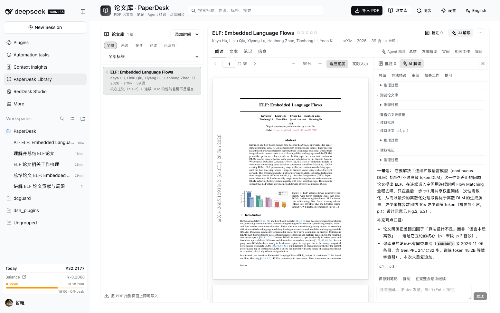

- 顶部一排任务：**总结 / 方法精读 / 审阅 / 相关工作 / 提问**。点一下，答案就在侧栏里流式出现；工具调用（读了哪几页、查了什么）以一行小字展示，推理过程可折叠。
- 底部可以**继续追问**（同一个会话，上下文连续）；运行中可**停止**。
- 答案里的页码引用会自动汇总成 `p.8 p.31 …` 芯片，点击直接跳到对应 PDF 页；**保存到笔记** 会把整段回答追加到论文笔记（摘要区），**复制** 复制全文。
- 需要完整会话界面时，点 **「在完整会话中继续」** 才会打开宿主会话（唯一的跳转入口）。
- 每篇论文对应一个隐藏的 AI 会话（标题 `AI · 论文名`），刷新/换论文后自动重新挂载并保留对话；会话仍属于论文库工作区。

选中的文字点 **提问**，会把「原文 + 你的问题」保存成提问批注，并在同一个 AI 侧栏里让 Agent 回答。

也可以在任意会话里直接说：「帮我总结论文库里那篇 Drifting 论文」，Agent 会自动搜索并读取。

## 对话跟着论文走

每篇论文可以有**多条独立对话**，由插件自己保存在 `papers/<id>/chats.json` 里，跟着论文库一起被网盘同步。AI 抽屉顶部的会话栏可以切换、新建、重命名、删除；每轮问答结束后自动保存 user/assistant 文本，引用页码照旧可点。

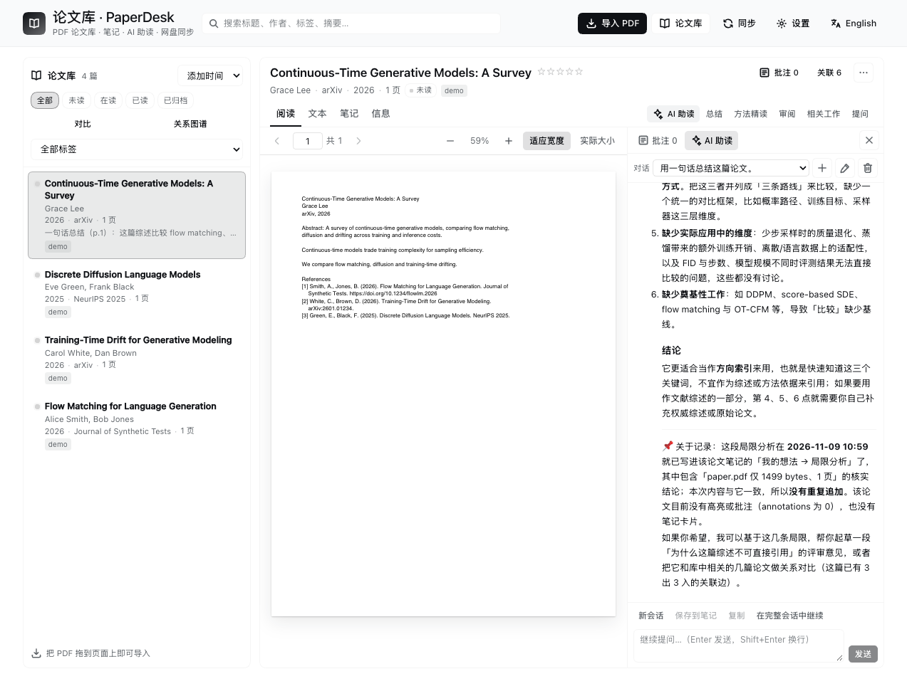

- 左侧栏的 DSH session 只是执行会话：**删掉 sidebar 里的 session，不会丢掉插件里保存的对话**。
- 如果某条对话对应的 session 已经失效/归档：打开它时会显示插件保存的历史记录，继续提问会**新建一个 session，并把历史记录带到新会话**里。
- 每条对话对应一个 sidebar session（执行期需要），但对话的归属、历史和切换都在插件面板里管理。
- 会话栏操作：`+` 新建对话，铅笔重命名，垃圾桶删除（带确认）；对话默认以第一条提问自动命名。
- 同步提醒：对话记录是普通 JSON，和论文一起走云盘；但 DSH 的 session id 是本机的，换机器后历史还在，继续提问会新建本地会话。

## 从 AI 回答生成笔记卡片

AI 侧栏里每条回答右下角有 **「生成卡片」**：打开编辑器，标题（自动取回答首句并截断）、正文（整段回答）、标签、引用页码（自动从 `p.N` 提取）都可以改，保存后出现在「笔记」页右侧的**卡片栏**：

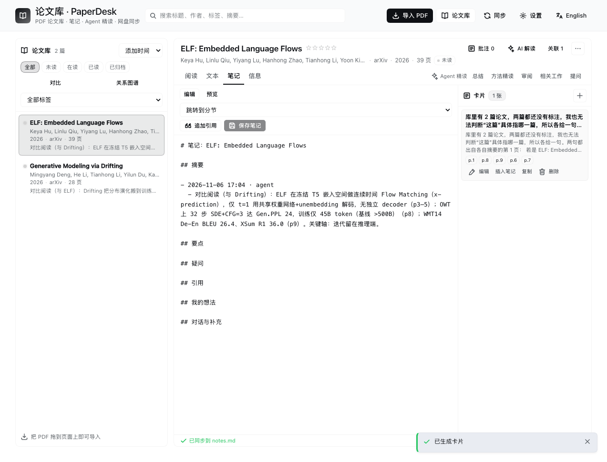

卡片支持 **编辑 / 插入笔记 / 复制 / 删除**，点页码芯片可直接跳到 PDF 对应页。卡片以 `cards.json` 存在论文目录里，随论文库同步；Agent 也能用 `paper_cards` 读取这些沉淀下来的结论。

## 多篇论文对比

论文库工具栏点 **「对比」**：勾选 2–6 篇论文（可搜索）→ 先看**元数据对比矩阵**（标题/作者/年份/期刊/状态/标签/页数/DOI）→ 点 **「生成 AI 对比」**，Agent 会逐篇读关键页并流式写出对比表、横向结论、建议关联和实际读过的页码：

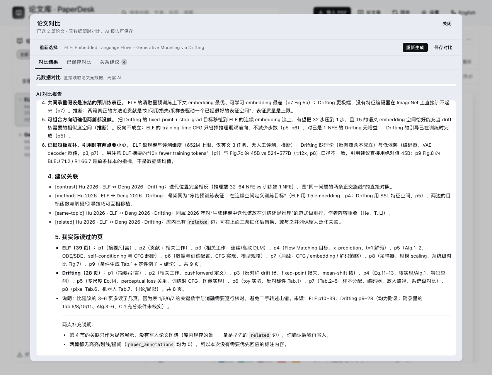

报告可 **保存对比**（存进 `<库>/comparisons/`），之后在「已保存对比」里回看/删除/用同一批论文重新生成。报告末尾的 `- [关系类型] 论文A ↔ 论文B：理由` 会被解析成「关系建议」，点 **加入图谱** 就写入下面的关联图谱：

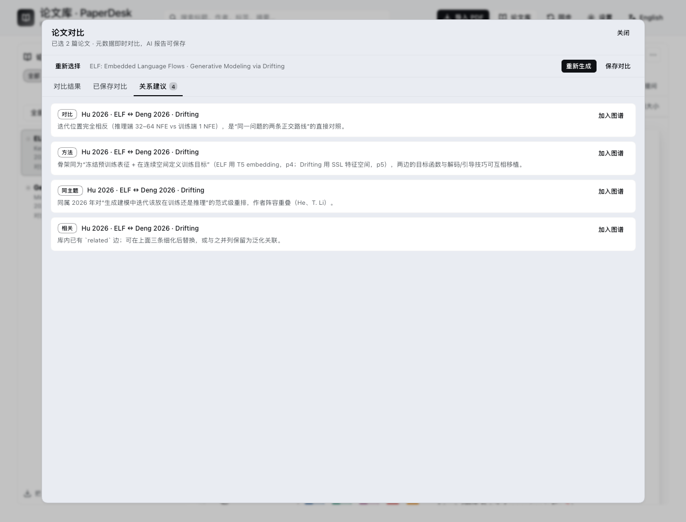

## 论文关联图谱

工具栏点 **「关系图谱」**：（也可在阅读器顶部点「关联 N」聚焦当前论文）

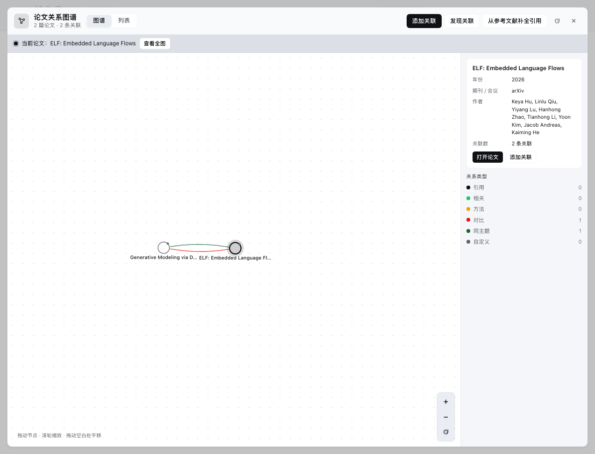

- 支持 6 种边：引用 / 相关 / 方法 / 对比 / 同主题 / 自定义；力导向布局，节点可拖拽、画布可缩放平移，悬停高亮邻居，点击节点看详情/打开论文/继续加边，点击边可删除。
- 同一对论文的多条关系会分叉绘制（上/下弧），不会互相遮挡。
- 「列表」页按条管理所有关系；「添加关联」里搜索选择两篇论文与关系类型，自动校验自环与重复。
- 关系存在 `.paperdesk/relations.json`，随论文库同步；Agent 可用 `paper_relations` 读取整张图（做跨论文分析时会用到），但 Agent **不会**自己写关系。

### 关系从哪来

| 方式 | 怎么用 | 自动程度 |
|---|---|---|
| 手动添加 | 图谱「添加关联」，或阅读器顶部「关联 N」→ 添加 | 全手动 |
| AI 发现 | 图谱「发现关联」：Agent 读标题/摘要/卡片/笔记，给出带理由的候选，勾选后「加入选中」才写入 | 半自动，先确认 |
| 引用补全 | 图谱「从参考文献补全引用」：解析 PDF 参考文献，把 DOI / arXiv 号 / 标题匹配到库内论文，建 `cites` 边 | 一键自动（可开关） |

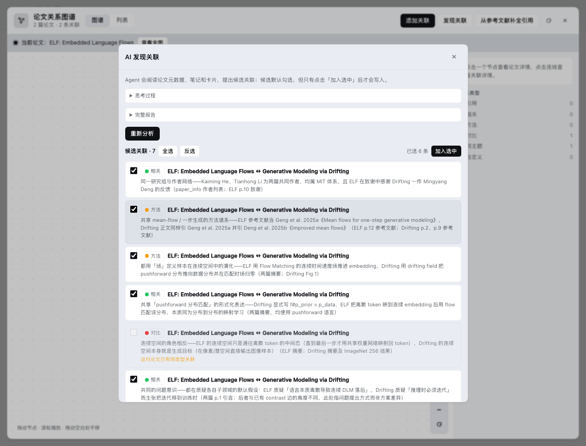

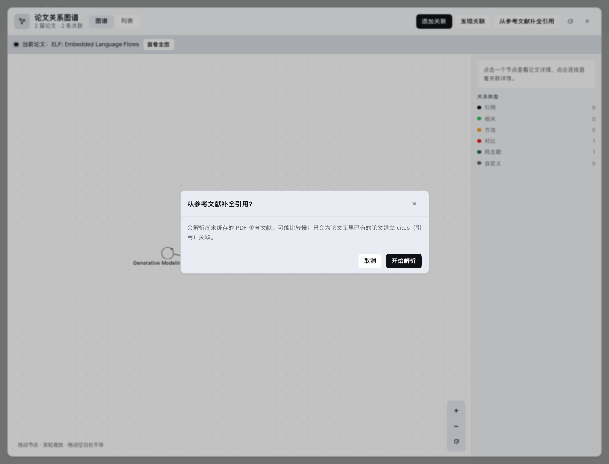

引用补全也可以在设置里打开 **「导入后自动解析参考文献补引用」**：导入完成后自动只扫这一篇的参考文献，补建库内 `cites` 关联，结果用 toast 提示，不影响导入本身。

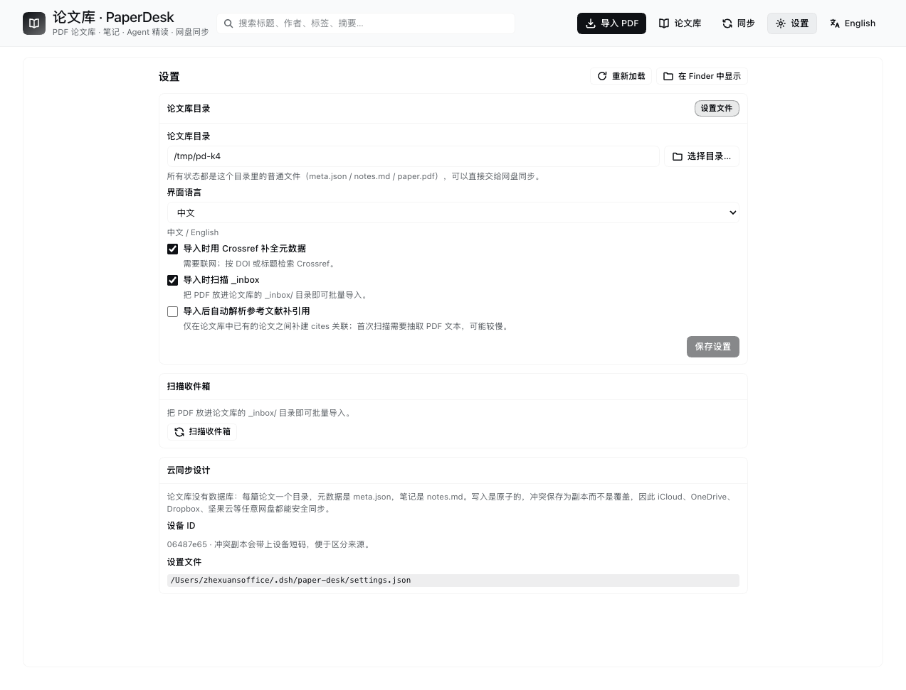

### 手动修改关系

点击任意一条边 → **编辑**：可以改关系类型、标签、备注；列表页每条关系也有「编辑」。保存后立即写入 `relations.json` 并同步刷新图谱/列表；重复类型等冲突会给出提示。

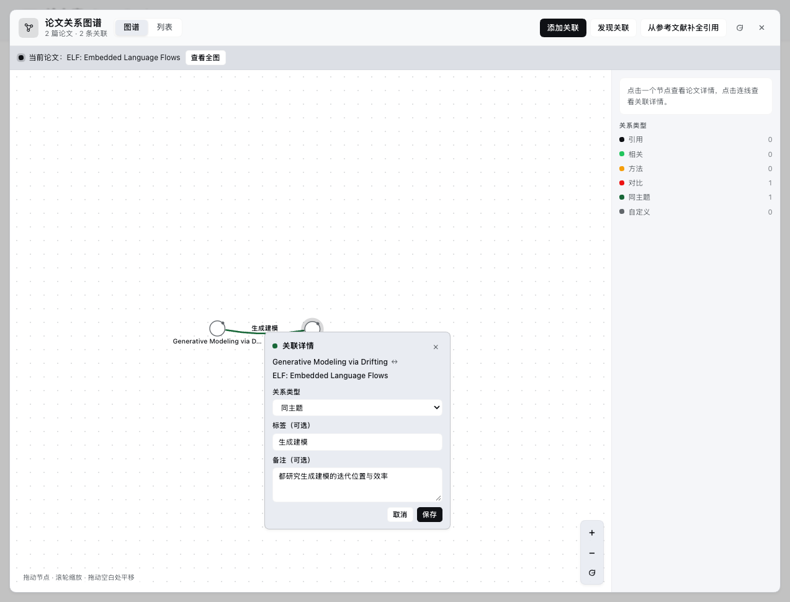

工具一览（模型可调用）：

| 工具 | 用途 |
| --- | --- |
| `paper_list` | 按状态/标签列出论文 |
| `paper_search` | 跨标题/作者/标签/摘要/笔记/正文搜索 |
| `paper_info` | 单篇元数据 + 笔记状态 |
| `paper_text` | 按页读抽取文本（首次抽取会缓存） |
| `paper_annotations` | 读取你在 PDF 上做的高亮/划线/备注/提问（含页码、原文、批注） |
| `paper_cards` | 读取某篇论文的笔记卡片（标题/正文/标签/页码） |
| `paper_relations` | 读取论文关系图谱（可按论文过滤；只读，Agent 不会自动写关系） |
| `paper_notes_read` / `paper_note_append` | 读笔记 / 追加笔记（冲突安全） |
| `paper_add` | 用本机绝对路径导入 PDF |
| `paper_update` | 改元数据、标签、状态、评分 |
| `paper_sync` | 网盘同步健康度、外部变更、冲突 |

## 安装到其它机器 / 发布到市场

本插件是标准 DSH 插件包（`dsh.bundle` + `cordis.patch.yml` + `lib/` 预构建产物），可以：

- 从本地目录安装：`dsh plugin --profile <profile> add /path/to/dsh-paper-desk`
- 从 npm 安装：`dsh plugin --profile <profile> add @zhe_xuan/dsh-paper-desk`
  （npm 上因与已有包 `dsh-paperdesk` 名称相近，包发布在 `@zhe_xuan` scope 下）
- 发布到社区市场：需要在 npm 发布，并向 [awesome-dsh-plugin](https://github.com/awesome-dsh-plugin/awesome-dsh-plugin) 提交一个条目（市场 dshmarket 从该列表同步）。

完整步骤、市场条目模板和自检清单见 **[docs/PUBLISHING.md](docs/PUBLISHING.md)**。

## 目录结构与同步原理

```
<论文库根>/
  papers/
    <paper-id>/
      paper.pdf        # 原始 PDF
      meta.json        # 元数据（含标签、状态、评分、sha256）
      notes.md         # 你的笔记（Markdown，固定分区）
      annotations.json # PDF 高亮/划线/备注/提问（页码 + 原文 + 批注）
      cards.json       # 从 AI 回答生成的笔记卡片
      chats.json       # 插件管理的该论文多条 AI 对话记录
      text.json        # 抽取文本缓存（可删，会重建）
  comparisons/       # 保存下来的多篇论文对比报告
  .paperdesk/
    relations.json   # 论文关联图谱（带类型的边）
  _inbox/            # 把 PDF 丢这里，点「扫描收件箱」自动导入
  .paperdesk/
    scan.json        # 文件指纹快照，用于发现其他设备/外部程序的改动
    conflicts/       # 冲突副本（永不覆盖你的原文）
    trash/           # 删除的论文（移动而非删除）
    cache/           # 临时导入暂存（可删）
```

* **所有内容都是普通文件**，因此任何网盘客户端都能同步；插件不写数据库、不写绝对路径索引。
* **冲突策略**：保存笔记时带上「读取时的内容哈希」。若文件已被其他设备/程序改过，本次保存不会覆盖，而是把内容写到 `.paperdesk/conflicts/` 并在界面提示。可在「同步」页选择「使用这个副本」或「丢弃副本」。
* **外部变更**：`scan.json` 记录每个文件的大小/修改时间。「同步」页显示「自上次扫描以来」其他设备新增/修改/删除的文件；点「重新扫描」建立新基线。
* **iCloud 占位文件**：文件被 iCloud 优化掉时显示「未下载」，可点按钮触发 `brctl download`（仅 macOS）。
* **多设备建议**：同一篇论文的笔记尽量避免两台设备同时编辑；网盘自身的冲突副本（如 `notes (conflicted copy).md`）也能在「同步」页看到。

## 设置

两种入口：面板里的「设置」页（推荐），或 profile 的 `cordis.patch.yml`（插件配置层）。运行时设置保存在 `~/.dsh/paper-desk/settings.json`，优先级 **settings.json > 插件 config > 环境变量**。

| 键 | 默认 | 说明 |
| --- | --- | --- |
| `libraryPath` | `''`（未配置） | 论文库根目录的绝对路径；也支持 `~/...`。 |
| `language` | `zh` | 界面与笔记分区语言（`zh` / `en`）。 |
| `enrich` | `true` | 导入/更新元数据时允许调用 Crossref（仅发送标题/DOI）。 |
| `autoImportInbox` | `true` | 保留给收件箱流程的开关。 |
| `maxPdfBytes` | `0` | 上传大小上限（字节），`0` = 不限制（默认）。上传流式写盘，不会因大文件占满内存。 |

环境变量 `DSH_PAPER_DESK_LIBRARY` 可在未配置时作为开发/临时目录回退。

## 数据与隐私

* 论文、笔记、元数据默认保存在你选择的本地目录。网盘客户端如何同步由你配置。
* 仅在启用 `enrich` 且需要补全元数据时，向 Crossref 发送标题或 DOI（含礼貌性 User-Agent），失败静默回退到本地推断。
* 使用 AI 时，读取的论文文字、笔记和你选择附上的 PDF 原页图片会进入当前会话，并由宿主发送给配置的模型服务。请按模型服务的数据处理规则使用。
* 文献发现会向 arXiv 发送检索词；不发送本地论文全文。

## 故障排查

| 现象 | 处理 |
| --- | --- |
| 左侧栏没有论文库图标 | 确认插件已启用：Plugin Manager → 论文库 PaperDesk；必要时禁用再启用，或刷新页面。 |
| 面板提示「无法连接 PaperDesk 后端」 | Host 端未激活；在 Plugin Manager 里禁用→启用 `paper-desk` 后重试。 |
| PDF 打开是空白 / 提示文件缺失 | 文件可能仍在网盘下载；到「同步」页点下载，或等网盘同步完成。 |
| 高亮/划线没有出现 | 扫描版 PDF 没有文字层，无法选中；请先 OCR 再导入。 |
| 「AI 解读」没出内容 | 侧栏状态会显示「正在连接会话…」或错误原因；重试或刷新页面。Agent 回答需要几十秒，期间可继续看 PDF。 |
| 搜索不到正文 | 这篇 PDF 还没抽取文本：打开它的「文本」页触发一次抽取；扫描版 PDF 无法抽取（可 OCR 后重新导入）。 |
| 保存笔记弹出冲突 | 说明磁盘上的笔记在别处被改过；选择「使用我的版本」会覆盖，或「加载磁盘版本」后合并。 |
| 元数据不准 | 「信息」页里手动改，或点「更新元数据」用 Crossref 重新补全（只填空字段）。 |

## 开发

```bash
cd /Users/zhexuansoffice/Developments/dsh_plugins/dsh-paper-desk
pnpm install          # 首次
npm run typecheck     # Host + 浏览器两套 TS
npm run build         # tsc -> lib/ + esbuild -> lib/client.js
npm run test:regression # 专题、搜索、关联、Atom 与多模态提交契约
node scripts/smoke.mjs [可选真实PDF路径]   # 领域冒烟测试
```

安装到 profile：在 Harness 里用 `plugin_manager` 的 `install_bundle`，目标为本目录的绝对路径。Host 端代码改动需要禁用/启用插件行来重新加载模块；浏览器端改动需要刷新页面（除非同时跑着 `pnpm run dev:web`）。

目录：`src/`（Host：目录/笔记/PDF/元数据/同步/批注/卡片/关系/对比/HTTP/工具/提示词）、`client/`（React 面板、pdf.js 阅读器、AI 侧栏、对比与图谱浮层）、`scripts/`（构建与冒烟）、`DESIGN.md` / `DESIGN-VIEWER.md` / `DESIGN-AI.md` / `DESIGN-FEATURES.md`（契约文档）。

---

## English summary

PaperDesk is a Mendeley-style paper library for DeepSeek Harness. Pick a directory (ideally inside iCloud Drive / Dropbox / Nutstore), then drag PDFs in: metadata is inferred and optionally enriched from Crossref, each paper gets a Markdown notes file with fixed sections, the built-in reader shows the PDF and extracted text, and one click hands the paper to the agent (summary / method / critique / related work / study questions) with a prepared prompt. Nine `paper_*` tools let any session list, search, read and annotate papers. A reproducible demo library (`demo/library/`, 4 synthetic papers and 10 relations) ships in the repo for trying the graph, and the package is prepared for npm + the community plugin market (see docs/PUBLISHING.md). Everything is plain files under your chosen root, so any cloud drive syncs it; writes are hash-guarded and conflicting edits become conflict copies instead of overwrites, with a Sync page for external changes, conflicts and iCloud placeholders.

Beyond reading, the library builds knowledge: AI answers become editable **note cards** next to your notes, any 2–6 papers can be **compared** (metadata matrix + an AI report that can be saved and reopened), and papers are linked in a typed **relation graph** (cites / related / method / contrast / same-topic / custom) with a force-directed view; relation suggestions from a comparison can be added to the graph in one click.
